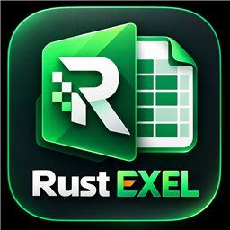

<p align="center">
  
</p>

<h1 align="center">Rust EXEL</h1>

<p align="center">
  <strong>A Professional, Native, Cross-Platform Spreadsheet, Formula Engine & Workbook Editor Built with Rust</strong>
</p>

<p align="center">
  <a href="#features">Features</a> •
  <a href="#architecture">Architecture</a> •
  <a href="#quickstart">Quickstart</a> •
  <a href="#file-formats">File Formats</a> •
  <a href="#contributing">Contributing</a> •
  <a href="#license">License</a>
</p>

<p align="center">
  
  
  
  
  
  
</p>

---

## 📖 Overview

**Rust EXEL** is an independent, native desktop spreadsheet application inspired by Microsoft Excel, engineered from the ground up in pure Rust. It delivers native performance, actual calculation semantics, and hardware-accelerated rendering through `egui` and `wgpu` (with automatic `glow` fallback) without web wrappers, Electron, or simulated grids.

Whether you're opening massive 100,000+ row datasets, computing complex nested formulas with cross-sheet dependencies, formatting tables, or exporting to Microsoft Excel-compatible `.xlsx`, Rust EXEL is designed for speed, safety, and productivity.

---

## ⚡ Key Highlights

- 🚀 **Full Excel Scale (1M+ Rows)**: Sparse matrix cell store supporting standard Excel limits (**1,048,576 rows × 16,384 columns / A through XFD**) without eager RAM allocation.
- 🎨 **Hardware-Accelerated Virtual Grid**: Custom `egui::Painter` engine that renders strictly visible rows and columns for silky smooth 60+ FPS navigation. Automatic fallback from Wgpu to Glow OpenGL ensures compatibility across all GPUs and virtual machines.
- 🧮 **True Formula Recalculation Engine**:
  - Directed Acyclic Graph (DAG) dependency tracking with Kahn's topological sort.
  - Automatic cycle detection powered by Tarjan's Strongly Connected Components algorithm (flags cycles with `#CIRCULAR!`).
  - Standard Excel functions: `SUM`, `PRODUCT`, `AVERAGE`, `COUNT`, `COUNTA`, `IF`, `AND`, `OR`, `NOT`, `IFERROR`, `VLOOKUP`, `INDEX`, `MATCH`, `CONCAT`, `LEFT`, `RIGHT`, `MID`, `LEN`, `MOD`, `SQRT`, `ROUND`, and more.
  - Full propagation of error types (`#DIV/0!`, `#VALUE!`, `#REF!`, `#NAME?`, `#N/A`, `#NUM!`).
- 📂 **High-Fidelity File Compatibility**:
  - **XLSX**: Native read & write support preserving values, formulas, fonts, fills, borders, alignments, and column widths.
  - **CSV / TSV / JSON**: Fast import and export with delimiter sniffing and automatic data-type inference.
  - **Atomic File Saving**: Secure replacement via `tempfile` so save operations never corrupt existing files.
  - **Macro Safety**: Automatically detects and quarantines VBA macros in `.xlsm` files without ever executing untrusted code.
- 📋 **Seamless Clipboard Integration**: RFC 4180-compliant TSV clipboard formatting and parsing (`exel-clipboard`) with system clipboard synchronization via `arboard`, allowing seamless copy/paste between Rust EXEL, Microsoft Excel, and Google Sheets.
- ⌨️ **Keyboard-First Excel Workflow**: Complete shortcut registry supporting Windows, Linux, and macOS (`F2` inline edit, `F4` cycle absolute references `$A$1` / `A$1` / `$A1`, `Alt+=` AutoSum, `Ctrl+Z` / `Ctrl+Y` undo/redo, `Ctrl+Arrows` region jump).
- 🖥️ **Full Desktop Ribbon UI**: 10 functional ribbon tabs (*File, Home, Insert, Page Layout, Formulas, Data, Review, View, Developer, Help*), Name Box with cell jumping, multiline expandable Formula Bar, and bottom sheet tabs with live selection statistics (**Average**, **Count**, **Sum**).
- 🛡️ **Startup & Error Resilience**: Automatic graphics renderer fallback (`wgpu` -> `glow`), diagnostic crash logging to `crash.log`, and safe image buffer validation.

---

## 🏗️ Workspace Architecture

The project is structured as a modular Cargo workspace with 25 independent crates and applications:

```
rust-exel/
├── apps/
│   ├── rust-exel/              # Native GUI desktop application (eframe + wgpu / glow fallback)
│   └── rust-exel-cli/          # Headless spreadsheet calculation, evaluation & batch conversion CLI
├── crates/
│   ├── exel-core/              # Coordinate models (CellCoord, CellRange, SheetId, A1 conversions)
│   ├── exel-cell/              # SparseCellStore, CellValue, CellState, and CellError models
│   ├── exel-workbook/          # Multi-sheet Workbook, Worksheet, dimensions, named ranges
│   ├── exel-dependency-graph/  # Directed graph, cycle detection, topological sorter
│   ├── exel-formula/           # Lexer, AST parser, cross-sheet reference resolution
│   ├── exel-calc/              # Formula evaluator, function registry, recalculation engine
│   ├── exel-formatting/        # Fonts, fills, borders, alignments, number format codes
│   ├── exel-commands/          # Concrete undoable commands (SetCell, InsertRow, DeleteCol, etc.)
│   ├── exel-history/           # Bounded history stack with transaction support
│   ├── exel-tables/            # Structured tables, table styles, structured references
│   ├── exel-validation/        # Data validation criteria (whole number, decimal, list, date, text length)
│   ├── exel-clipboard/         # RFC-compliant TSV serialization/parsing & system clipboard integration
│   ├── exel-io/                # Generic I/O traits, format sniffing, and atomic file persistence
│   ├── exel-csv/               # CSV, TSV, and JSON importers and exporters
│   ├── exel-xlsx/              # High-fidelity XLSX read/write adapter (calamine & rust_xlsxwriter)
│   ├── exel-shortcuts/         # Central cross-platform ShortcutRegistry (Windows, Linux, macOS)
│   ├── exel-charts/            # Chart configurations, series extraction, visual styles
│   ├── exel-pivot/             # Multi-dimensional pivot table aggregation engine
│   ├── exel-data/              # Data analysis tools, sorting, quick filters, transformations
│   ├── exel-print/             # Page setup, paper sizes, print area, and ASCII/PDF print preview
│   ├── exel-automation/        # Batch scriptable automation runner (JSON scripts)
│   └── exel-ui/                # Virtualized grid, Ribbon, Formula Bar, Sheet tabs, Format dialog
└── assets/
    └── icons/                  # Application icons and branding assets
```

---

## 🚀 Quickstart

### Prerequisites
- [Rust Stable](https://www.rust-lang.org/) (1.85.0 or later)

### Build & Run Desktop App

```bash
# Clone the repository
git clone https://github.com/Sami12901/RustEXCEL.git
cd RustEXCEL

# Run the native desktop application
cargo run --bin rust-exel

# Run in optimized release mode
cargo run --release --bin rust-exel
```

### Run Tests

```bash
# Run all 295 unit and integration tests across the workspace
cargo test --workspace
```

### Headless CLI Tool

```bash
# Evaluate a formula
cargo run --bin rust-exel-cli -- eval "SUM(10, 20, 30) * 2"

# Convert XLSX to CSV
cargo run --bin rust-exel-cli -- convert input.xlsx output.csv

# Inspect sheet info
cargo run --bin rust-exel-cli -- info workbook.xlsx
```

---

## 🛡️ Security & Untrusted File Safety

1. **No Macro Execution**: Embedded VBA code in XLSM files is quarantined and never executed.
2. **Safe Atomic Persistence**: Files are written to temporary storage and validated before replacing the destination file.
3. **Memory Safety**: Pure Rust implementation guarantees zero buffer overflows or dangling pointers.

---

## 📄 License

Dual-licensed under either:
- **MIT License** ([LICENSE](LICENSE) or http://opensource.org/licenses/MIT)
- **Apache License, Version 2.0** (http://www.apache.org/licenses/LICENSE-2.0)

at your option.

---

<p align="center">
  Crafted with ❤️ in Rust
</p>
